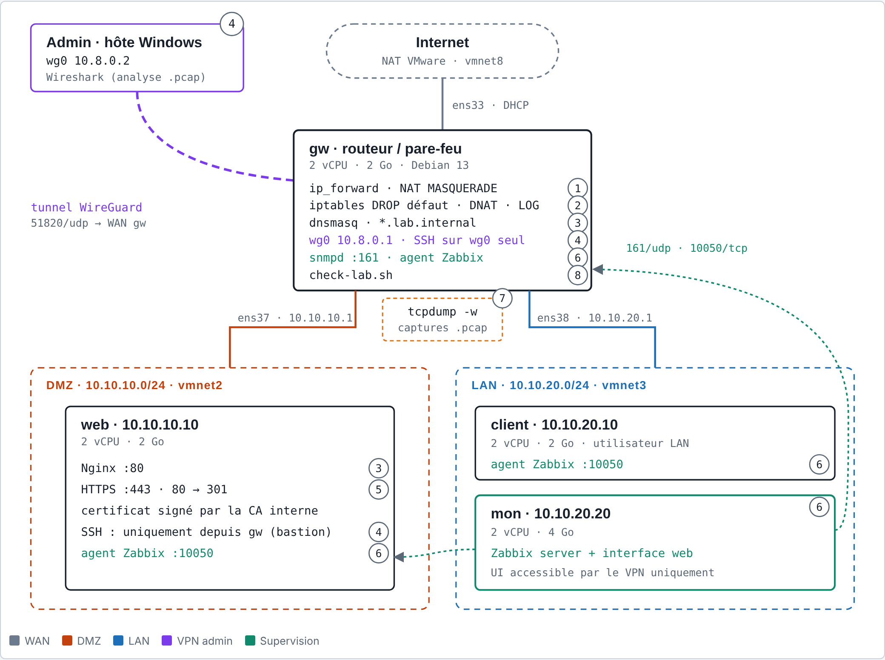
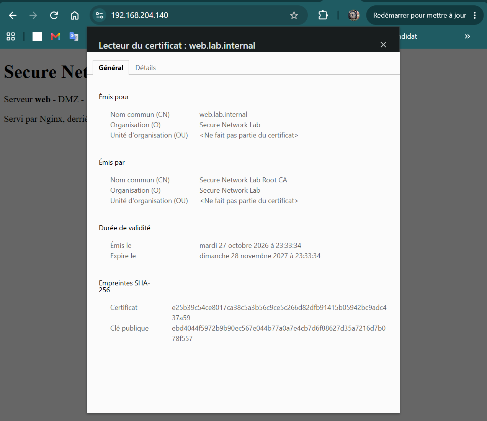

<div align="center">

# 🔐 Secure Network Lab

**Lab réseau sécurisé sur 4 VMs Debian : routeur-pare-feu Linux en politique *Default Deny*,<br>DMZ HTTPS, administration par VPN et supervision**


[Architecture](#architecture) • [Sécurité](#securite) • [Supervision](#supervision) • [Analyse de trafic](#analyse-de-trafic) • [Tests](#tests)

</div>

---

## 📌 Présentation

Ce projet reproduit, à petite échelle, le réseau d'une entreprise : un **site web public en DMZ**, des **postes internes** dans un LAN, et un **routeur-pare-feu Linux** qui contrôle chaque flux entre les deux et Internet.

Tout est construit à la main sur Debian 13, sans appliance : le routage, le NAT et le filtrage avec **iptables**, le DNS avec **dnsmasq**, le VPN avec **WireGuard**, la PKI avec **OpenSSL**, et la supervision avec **Zabbix**. Chaque mesure de sécurité est **prouvée** par un test, une capture réseau ou un log.

**Ce que le lab démontre :**

- une politique **Default Deny** : tout est refusé, sauf les flux explicitement autorisés ;
- une **DMZ isolée** : un serveur web compromis ne peut pas atteindre le réseau interne ;
- une administration **uniquement par VPN**, avec un bastion SSH et une authentification par clé ;
- un site en **HTTPS**, avec un certificat signé par une **CA interne** ;
- une **supervision** qui détecte une panne de service en moins d'une minute ;
- un script qui **vérifie tout le lab** en une commande.

---

<a id="architecture"></a>
## 🏗️ Architecture



*Le numéro sur chaque élément indique la phase où il a été construit. Version interactive, avec plan d'adressage, matrice des flux et suivi des phases : [docs/architecture.html](docs/architecture.html) (à télécharger et ouvrir dans un navigateur).*

### Les machines

| VM | Rôle | vCPU / RAM | Services |
|---|---|---|---|
| **gw** | Routeur, pare-feu, passerelle de la DMZ et du LAN | 2 / 2 Go | iptables, dnsmasq, WireGuard, snmpd, agent Zabbix |
| **web** | Serveur web public, en DMZ | 2 / 2 Go | Nginx (HTTPS), agent Zabbix |
| **client** | Poste utilisateur du LAN, sert aux tests | 2 / 2 Go | agent Zabbix |
| **mon** | Supervision | 2 / 4 Go | Zabbix server, PostgreSQL, Nginx |

Les 4 VMs sont des clones d'un même template Debian 13 (mode texte, `machine-id` et clés SSH régénérés à chaque clone).

### Plan d'adressage

| Machine | Interface | Adresse | Réseau | Rôle |
|---|---|---|---|---|
| gw | ens33 | DHCP (192.168.204.140) | VMnet8 (NAT) | WAN |
| gw | ens37 | 10.10.10.1/24 | VMnet2 | Passerelle DMZ |
| gw | ens38 | 10.10.20.1/24 | VMnet3 | Passerelle LAN |
| gw | wg0 | 10.8.0.1/24 | tunnel | Serveur VPN |
| web | ens33 | 10.10.10.10/24 | VMnet2 | Serveur web |
| client | ens33 | 10.10.20.10/24 | VMnet3 | Poste utilisateur |
| mon | ens33 | 10.10.20.20/24 | VMnet3 | Supervision |
| admin | wg0 | 10.8.0.2/32 | tunnel | Poste d'administration |

Domaine interne : **`lab.internal`** (`web.lab.internal`, `mon.lab.internal`…). Détails : [docs/plan-adressage.md](docs/plan-adressage.md).

---

<a id="securite"></a>
## 🛡️ Sécurité

### Matrice des flux

Politique par défaut : **DROP** sur `INPUT` et `FORWARD`. Seuls ces flux sont autorisés, tout le reste est bloqué et journalisé (`FW-DROP-*`).

| Source | Destination | Ports | Décision |
|---|---|---|---|
| LAN | Internet | tous | ✅ |
| DMZ | Internet | 80, 443, 123 + ping | ✅ filtrage en sortie |
| LAN | web | 80, 443 + ping | ✅ |
| Internet | web (DNAT via gw) | 80, 443 | ✅ |
| DMZ, LAN | gw (dnsmasq) | 53 | ✅ |
| Internet | gw | UDP 51820 (WireGuard) | ✅ |
| VPN | gw | 22 | ✅ seul accès d'administration |
| VPN | mon | 80 | ✅ interface Zabbix |
| mon | gw, web | 10050 (agent), 161 (SNMP, gw) | ✅ |
| **DMZ** | **LAN** | tous | ❌ |
| LAN, Internet | toute machine | 22 | ❌ |
| DMZ | Internet | 53 (DNS direct) | ❌ le DNS passe obligatoirement par gw |

Le pare-feu complet tient dans un seul script versionné : [`gw/usr/local/sbin/firewall.sh`](gw/usr/local/sbin/firewall.sh), lancé au démarrage **avant le réseau** par un service systemd.

### Défense en profondeur

| Couche | Mesure |
|---|---|
| **Réseau** | Default Deny, DMZ isolée du LAN, filtrage en sortie de la DMZ, journalisation limitée des paquets rejetés |
| **DNS** | dnsmasq n'écoute que sur la DMZ et le LAN (pas de résolveur ouvert), la DMZ ne peut interroger que lui (traçabilité, protection contre le tunnel DNS) |
| **Administration** | Accès uniquement par **WireGuard** ; SSH fermé sur le WAN ; **bastion** : web, client et mon n'acceptent SSH que depuis gw |
| **SSH** | Clés Ed25519 uniquement, pas de root, `AllowUsers` par source, `MaxAuthTries 3`, redirection de ports interdite sauf sur le bastion |
| **Chiffrement** | HTTPS (TLS 1.2/1.3), redirection HTTP → HTTPS, certificat signé par une **CA interne** dont la clé privée reste hors ligne |
| **Supervision** | Agents Zabbix en **mode passif** (aucun flux DMZ → LAN), SNMP **v3 authPriv** (SHA-256 / AES), v2c désactivé |
| **Système** | Services inutiles désactivés (avahi), clés privées et secrets jamais versionnés |

---

## 🧭 Construction par phases

| Phase | Contenu | Documentation |
|---|---|---|
| 0 | Template Debian, clones, réseaux VMware, IP fixes, bastion SSH | [plan d'adressage](docs/plan-adressage.md) |
| 1 | Routage (`ip_forward`) et NAT `MASQUERADE` | [phase 1](docs/phase-1-routage-nat.md) |
| 2 | Pare-feu iptables Default Deny, journalisation, service systemd | [phase 2](docs/phase-2-pare-feu.md) |
| 3 | Nginx en DMZ, DNAT, DNS interne dnsmasq | [phase 3](docs/phase-3-web-dns.md) |
| 4 | Clés SSH, VPN WireGuard, durcissement SSH | [phase 4](docs/phase-4-vpn-ssh.md) |
| 5 | PKI interne OpenSSL et HTTPS | [phase 5](docs/phase-5-pki-https.md) |
| 6 | Supervision Zabbix (agents, SNMPv3, alertes) | [phase 6](docs/phase-6-supervision.md) |
| 7 | Analyse de trafic tcpdump / Wireshark | [phase 7](docs/phase-7-analyse-trafic.md) |
| 8 | Script de vérification `check-lab.sh` | [phase 8](docs/phase-8-check-lab.md) |

Chaque phase a été validée par des tests **avant / après** avant de passer à la suivante.

---

## 🔑 PKI et HTTPS

```
Secure Network Lab Root CA   (RSA 4096 · 10 ans · CA:TRUE, pathlen:0 · clé hors ligne)
        │ signe
        ▼
web.lab.internal             (RSA 2048 · 397 jours · serverAuth · SAN : 2 noms + 2 IP)
```

| Test depuis client | Avant installation de la CA | Après |
|---|---|---|
| `curl https://web.lab.internal` | `curl: (60) unable to get local issuer certificate` | page affichée |
| `openssl s_client` | `Verify return code: 20` | `Verify return code: 0 (ok)` |

Le serveur n'a pas changé entre les deux : seule la confiance du client a changé.



---

<a id="supervision"></a>
## 📊 Supervision

**Zabbix 7.0 LTS** sur mon (PostgreSQL en écoute locale uniquement, interface web accessible seulement par le VPN).

- **gw, web, client** : agent Zabbix 2 en **mode passif**. C'est mon qui ouvre la connexion : la règle « DMZ → LAN interdit » reste intacte.
- **gw-snmp** : gw est aussi supervisé en **SNMP v3**, pour reproduire la supervision d'un équipement réseau sans agent (routeur, switch, pare-feu matériel). En production, une seule méthode serait gardée.
- **Test d'alerte** : Nginx est surveillé de l'intérieur (`proc.num[nginx]`, gravité *High*) et de l'extérieur (`net.tcp.service[https,,443]`, gravité *Disaster*). Un arrêt de Nginx est détecté en moins d'une minute, puis résolu automatiquement au redémarrage.


---

<a id="analyse-de-trafic"></a>
## 🔬 Analyse de trafic

Captures réalisées avec `tcpdump` sur gw, analysées dans Wireshark.

| Capture | Constat |
|---|---|
| HTTP | Requête et réponse entièrement lisibles (URL, `Host`, `User-Agent`, HTML) |
| HTTPS | Seul le nom du site (SNI) reste visible ; tout le reste est chiffré (TLS 1.3) |
| WireGuard, côté WAN | Uniquement des paquets WireGuard chiffrés : ni adresse interne, ni protocole visible |
| WireGuard, dans `wg0` | SSH (lui-même chiffré), ping, interface Zabbix |
| Paquet bloqué | SYN de web vers client:22 visibles à l'entrée de gw, retransmis sans réponse, absents à la sortie : jetés par `FORWARD` |

| HTTP en clair | HTTPS : seul le SNI est visible |
|---|---|
|  |  |

| WireGuard vu du WAN | Paquet bloqué par le pare-feu |
|---|---|
|  |  |

---

<a id="tests"></a>
## ✅ Vérification automatique : `check-lab.sh`

Un script de non-régression rejoue **21 tests** depuis la machine concernée (par SSH, via le VPN et le bastion) : accès d'administration, services, routage, pare-feu, DNS, HTTPS et supervision. Chaque test indique s'il doit **réussir** ou **échouer** : un test de sécurité vérifie souvent qu'un flux interdit est bien bloqué.

```bash
./scripts/check-lab.sh      # code retour 0 = tout est OK, 1 = au moins un échec
```

| Tout fonctionne | Nginx arrêté sur web |
|---|---|
|  |  |

Un seul service arrêté fait échouer 4 tests : le script montre immédiatement l'étendue d'une panne. Le code retour permet de l'utiliser dans une tâche planifiée ou une CI.

---

## 📁 Structure du dépôt

Les fichiers de configuration reprennent le chemin qu'ils ont sur chaque machine.

```
secure-network-lab/
├── gw/
│   ├── etc/
│   │   ├── network/interfaces
│   │   ├── sysctl.d/99-routage.conf
│   │   ├── dnsmasq.d/lab.conf
│   │   ├── snmp/snmpd.conf
│   │   ├── ssh/sshd_config.d/10-durcissement.conf
│   │   ├── systemd/system/firewall.service
│   │   └── wireguard/wg0.conf.example
│   └── usr/local/sbin/firewall.sh
├── web/
│   ├── etc/nginx/          (nginx.conf, sites-available/secure-network-lab)
│   ├── etc/ssh/sshd_config.d/10-durcissement.conf
│   └── var/www/html/index.html
├── client/etc/              (interfaces, resolv.conf, sshd)
├── mon/
│   ├── etc/zabbix/          (nginx.conf, php-fpm.conf, agent exemple)
│   └── zabbix-export/web.yaml
├── pki/                     (ca.crt, ca.cnf, web.cnf, web-ext.cnf, web.crt)
├── scripts/check-lab.sh
└── docs/                    (une page par phase, captures, preuves)
```

**Jamais versionnés** (`.gitignore`) : clés privées (`*.key`, `wg0.conf`), mots de passe (Zabbix, SNMP), captures réseau brutes (`*.pcap`).

---

## 🚀 Reproduire le lab

**Prérequis** : VMware Workstation, environ 10 Go de RAM libres, une ISO Debian 13 (netinst, sans environnement de bureau).

1. Créer un template Debian 13 en mode texte, vider `/etc/machine-id` et les clés SSH, puis le cloner 4 fois.
2. Créer **VMnet2** et **VMnet3** en *Host-only*, sans DHCP ni carte hôte. Brancher gw sur NAT + VMnet2 + VMnet3, web sur VMnet2, client et mon sur VMnet3.
3. Identifier les interfaces de gw par leur adresse MAC, puis déployer les fichiers du dossier de chaque machine à leur emplacement.
4. Sur gw : `systemctl enable --now firewall wg-quick@wg0 dnsmasq snmpd`.
5. Générer les clés WireGuard (`wg genkey`) et la CA (`pki/`), en gardant les clés privées hors du dépôt.
6. Installer Zabbix 7.0 sur mon, les agents sur les autres VMs, puis importer `mon/zabbix-export/web.yaml`.
7. Lancer `./scripts/check-lab.sh` : tous les tests doivent être au vert.

Le détail de chaque étape est dans la documentation de la phase correspondante.

---

## 🧩 Difficultés rencontrées

| Problème | Résolution |
|---|---|
| Interfaces de gw nommées `ens37`/`ens38` au lieu des noms prévus | Correspondance établie en comparant les adresses MAC (Linux et VMware), confirmée par l'adresse IPv6 EUI-64 |
| Plus d'accès SSH aux VMs placées sur des réseaux isolés | Bastion SSH avec `ProxyJump` via gw, puis via le VPN |
| Horodatage incohérent des logs | Fuseau horaire des VMs corrigé en `Europe/Paris` |
| Service avahi (mDNS) découvert en écoute sur toutes les interfaces | Désactivé sur toutes les VMs |
| Git Bash ne profitait pas de l'agent SSH Windows | Utilisation explicite du client OpenSSH de Windows |
| Zabbix ne découvrait qu'une carte réseau sur gw, sans aucune erreur | `zabbix_get` montrait 5 cartes ; le test de la règle LLD révélait que l'hôte interrogeait l'IP de web. IP corrigée, historique faux effacé |
| Délais des retransmissions TCP différents de la théorie | Capture Wireshark : noyau récent avec `tcp_syn_linear_timeouts` (4 premiers SYN à 1 s d'intervalle) |
| Test de ping instable dans `check-lab.sh` | 3 essais au lieu d'un seul |

---

## ⚠️ Limites et améliorations

- **Supervision dans le LAN** : en entreprise, elle serait dans une zone d'administration dédiée.
- **Interface Zabbix en HTTP**, protégée par le tunnel WireGuard mais lisible depuis gw : passage en HTTPS avec la CA interne.
- **PKI** : pas de révocation (CRL/OCSP), pas de `nameConstraints`, renouvellement manuel.
- **Alertes** : pas d'envoi par e-mail (pas de serveur SMTP dans le lab).
- **Pare-feu** : iptables (couche de compatibilité nftables) ; une version native nftables serait plus moderne.
- **Automatisation** : déploiement manuel, documenté ; une étape suivante serait de le décrire avec Ansible.

---

## 🎯 Compétences mises en œuvre

`Routage et NAT Linux` · `Filtrage stateful iptables` · `DMZ et segmentation` · `DNS interne` · `VPN WireGuard` · `Durcissement SSH et bastion` · `PKI et TLS` · `Supervision Zabbix et SNMPv3` · `Analyse de paquets` · `Scripting Bash` · `systemd` · `Documentation et Git`

---