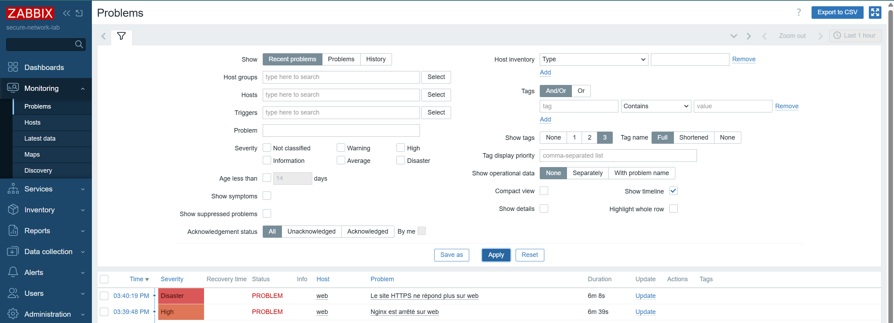
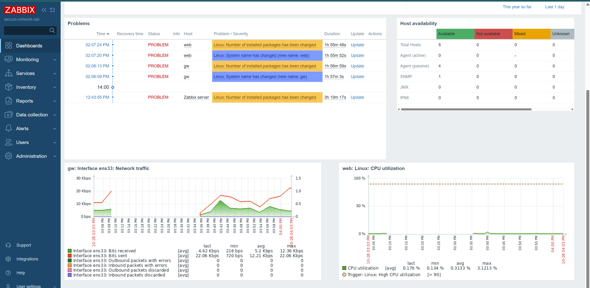

# Phase 6 : supervision avec Zabbix

## Objectif
Superviser les 4 VMs avec Zabbix 7.0 LTS, détecter automatiquement une panne de service, sans affaiblir le cloisonnement réseau.

## Architecture
- **mon** : serveur Zabbix + PostgreSQL (écoute en local uniquement) + interface web (accessible uniquement par le VPN)
- **gw, web, client** : agent Zabbix 2 en **mode passif** (mon → agent, port 10050). Le mode actif aurait imposé un flux DMZ → LAN
- **gw-snmp** : gw supervisé aussi en **SNMP v3 authPriv** (SHA-256 / AES), pour reproduire la supervision d'un équipement réseau sans agent. En production, une seule méthode serait gardée

## Règles de pare-feu ajoutées
| Source | Destination | Port | Rôle |
|---|---|---|---|
| VPN | mon | 80/tcp | Interface web Zabbix |
| mon | gw | 10050/tcp, 161/udp | Agent + SNMP |
| mon | web | 10050/tcp | Agent (LAN → DMZ) |

## Test d'alerte
Arrêt de Nginx sur web à [heure] → `Nginx est arrêté` détecté en [X] s, `Le site HTTPS ne répond plus` en [Y] s. Redémarrage → résolution automatique.

## Difficultés rencontrées
- Une seule carte réseau découverte sur gw : l'hôte avait été créé avec l'IP de web. Diagnostic : `zabbix_get` (l'agent voit 5 cartes) puis bouton *Test* de la règle LLD (qui interrogeait `10.10.10.10`)
- Découverte des interfaces lente (intervalle d'1 h) → *Execute now*

## Limites
- Pas d'envoi d'alertes par e-mail (pas de serveur SMTP dans le lab)
- Interface Zabbix en HTTP (protégée par le tunnel WireGuard) : HTTPS avec la CA interne possible