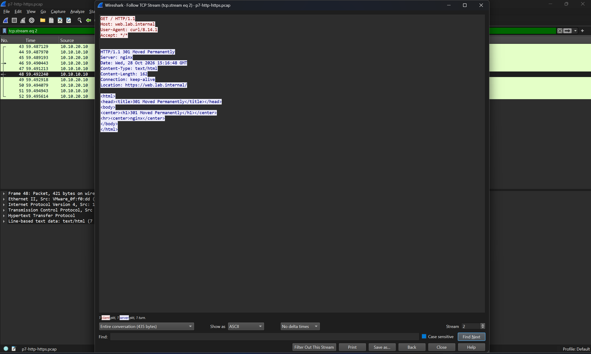
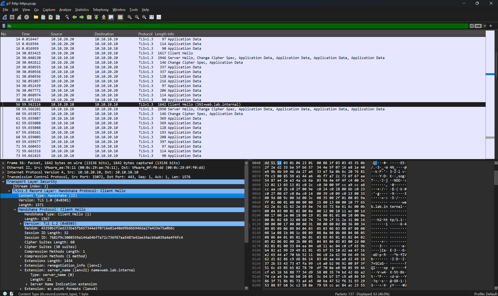
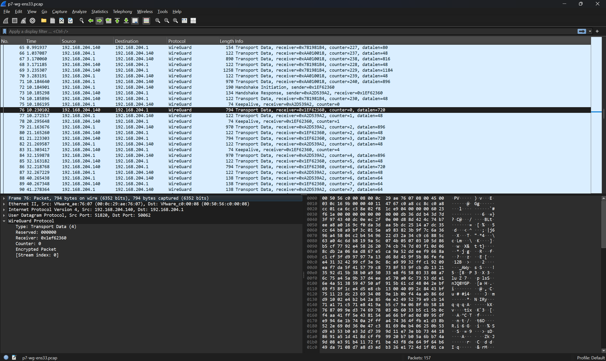
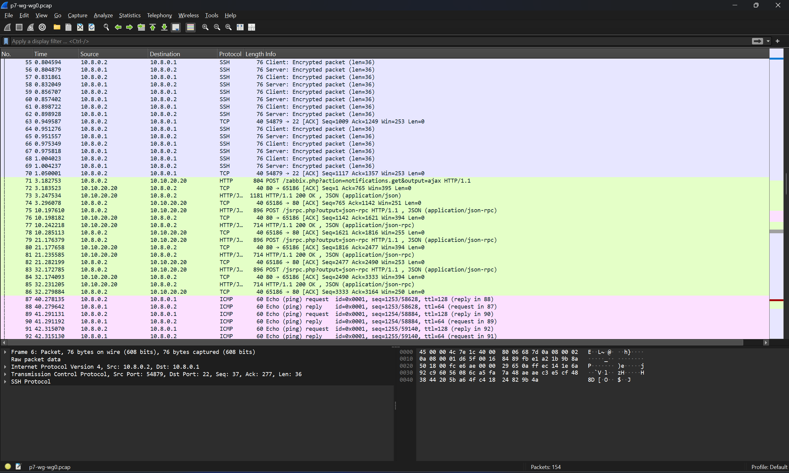
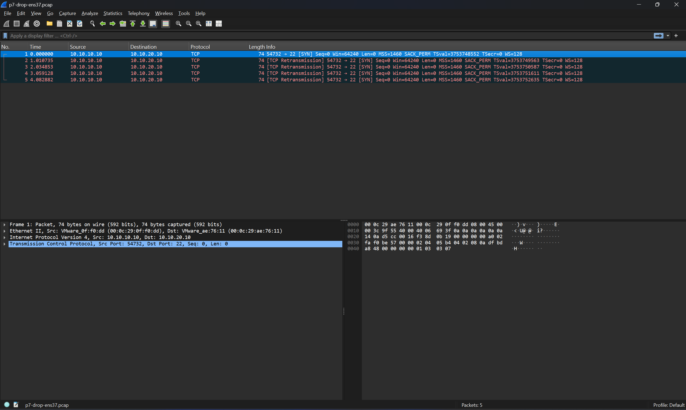
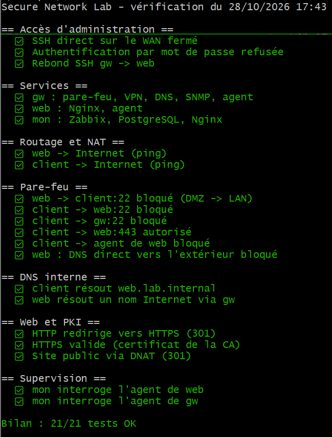
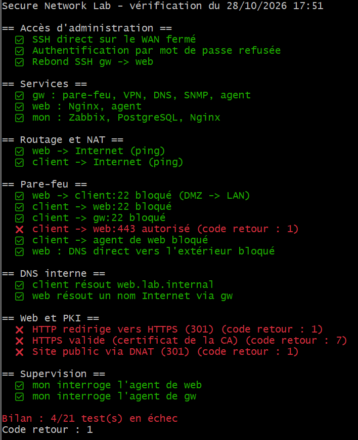

# Phase 7 : analyse de trafic

## Méthode
Capture avec `tcpdump -w` sur gw (là où tout le trafic passe), analyse dans Wireshark sur le poste admin. Les fichiers `.pcap` ne sont pas publiés (adresses et données internes).

## 1. HTTP contre HTTPS (carte DMZ de gw)
- HTTP : *Follow TCP Stream* affiche toute la requête et la réponse en clair (URL, `Host`, `User-Agent`, HTML)
- HTTPS (TLS 1.3) : seul le nom du site reste visible, dans le SNI du `Client Hello` ; tout le reste est `Application Data` chiffré
- Observation : les tests de supervision Zabbix (mon → web:443) apparaissent toutes les 30 s, sans SNI




## 2. WireGuard (cartes ens33 et wg0, capturées en même temps)
- WAN : uniquement des paquets WireGuard (`Transport Data`, `Handshake`, `Keepalive`) entre l'hôte et gw
- wg0 : SSH (contenu chiffré par SSH), ping, et l'interface Zabbix en HTTP clair
- Limite constatée : les tailles et le rythme restent visibles côté WAN (analyse de trafic) ; l'interface Zabbix devrait passer en HTTPS pour un chiffrement de bout en bout




## 3. Paquet bloqué (cartes ens37 et ens38)
SYN de web vers client:22 visibles sur ens37, retransmis à 1 s puis 2 s, aucun paquet sur ens38, lignes `FW-DROP-FWD` dans les logs : le paquet est jeté par la chaîne FORWARD.




## ✅ Vérification automatique : `check-lab.sh`

Un script de non-régression rejoue **21 tests** depuis la machine concernée (par SSH, via le VPN et le bastion) : accès d'administration, services, routage, pare-feu, DNS, HTTPS et supervision. Chaque test indique s'il doit **réussir** ou **échouer** : un test de sécurité vérifie souvent qu'un flux interdit est bien bloqué.

```bash
./scripts/check-lab.sh      # code retour 0 = tout est OK, 1 = au moins un échec
```

| Tout fonctionne | Nginx arrêté sur web |
|---|---|
|  |  |

Un seul service arrêté fait échouer 4 tests : le script montre immédiatement l'étendue d'une panne. Le code retour permet de l'utiliser dans une tâche planifiée ou une CI.